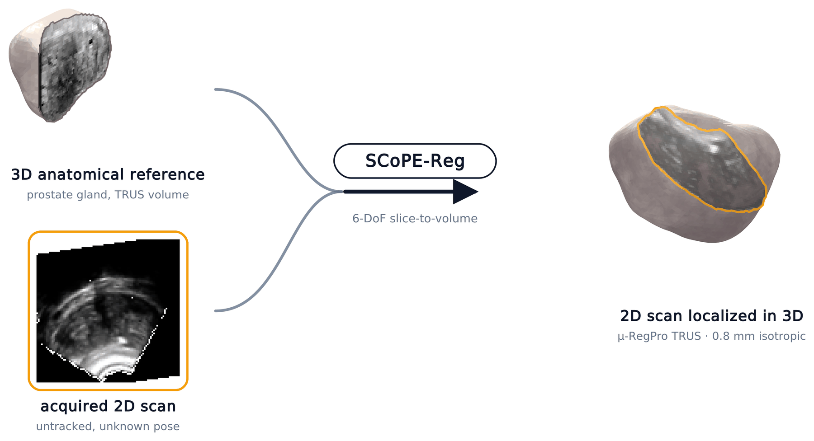
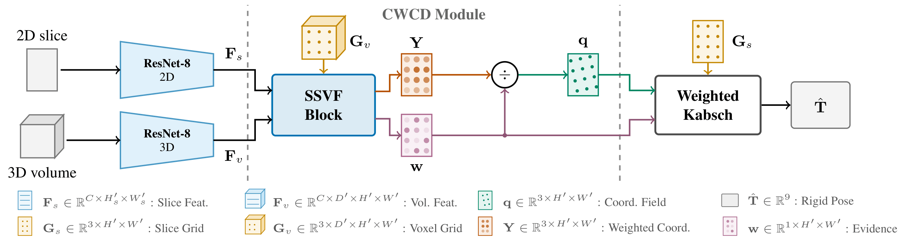
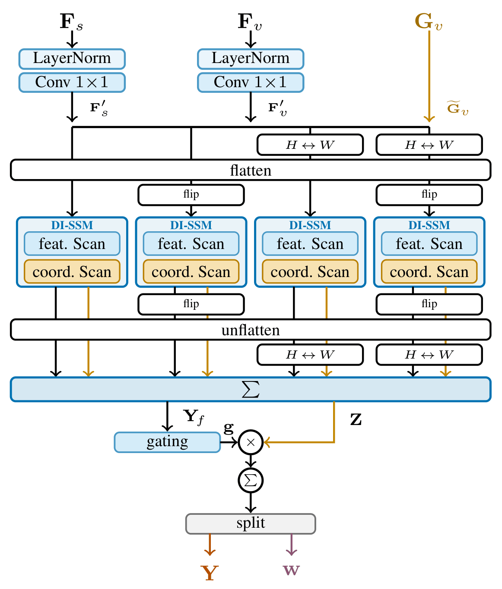
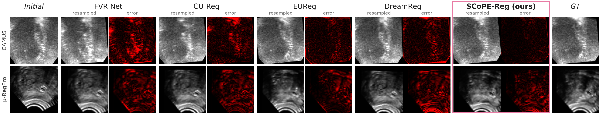
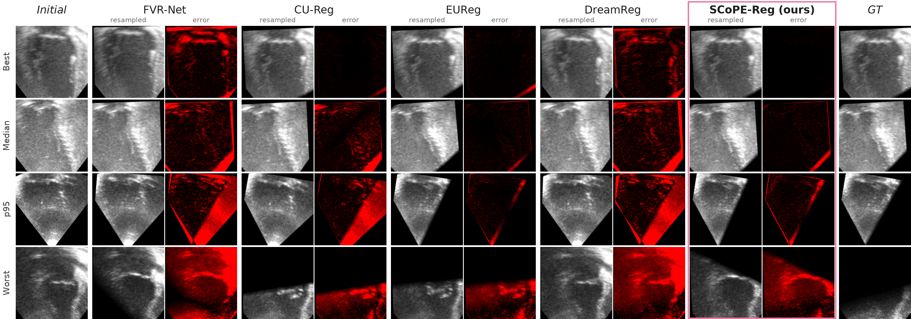
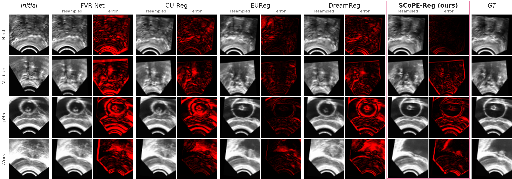

<div align="center">

# SCoPE-Reg

### Efficient Rigid Ultrasound Slice-to-Volume Registration via State-Space Correlation and Closed-Form Pose Estimation

Niklas Schwarz<sup>1</sup> &nbsp;·&nbsp; Jens Kleesiek<sup>1,2,3,4,5,6</sup> &nbsp;·&nbsp; Moritz Rempe<sup>1,2,7</sup>

<sub><sup>1</sup>Institute for AI in Medicine (IKIM), University Hospital Essen &nbsp;
<sup>2</sup>Cancer Research Center Cologne Essen (CCCE) &nbsp;
<sup>3</sup>RACOON Study Group, Site Essen &nbsp;
<sup>4</sup>Department of Physics, TU Dortmund &nbsp;
<sup>5</sup>German Cancer Consortium (DKTK), Partner Site Essen &nbsp;
<sup>6</sup>University of Duisburg-Essen &nbsp;
<sup>7</sup>Brigham and Women's Hospital, Harvard Medical School</sub>

**Accepted at WACV 2027**

[](https://arxiv.org/abs/2608.28715)
[](https://arxiv.org/abs/2608.28715)
[](LICENSE)
[](#1-environment)
[](#1-environment)

[**Paper**](https://arxiv.org/abs/2608.28715) &nbsp;|&nbsp;
[**Setup**](#1-environment) &nbsp;|&nbsp;
[**Data**](#2-download-the-data) &nbsp;|&nbsp;
[**Checkpoints**](#41-evaluate-the-provided-checkpoints) &nbsp;|&nbsp;
[**Method**](#5-how-it-works) &nbsp;|&nbsp;
[**Results**](#6-results) &nbsp;|&nbsp;
[**Citation**](#citation)



</div>

**SCoPE-Reg localizes an untracked 2D ultrasound frame inside a 3D reference volume.** Instead of regressing the six-degree-of-freedom pose directly, it predicts the 3D volume coordinate of every encoded slice location together with an evidence weight, then recovers the pose in closed form with a parameter-free weighted Kabsch layer. A selective state-space (Mamba) scan builds these correspondences in linear time, so the slice–volume affinity matrix of cross-attention is never materialized and the parameter count does not depend on the input resolution.

<div align="center">

| 0.73 mm | 2.27 mm | 100 % / 80 % | 6.49 M | 51 FPS |
|:--:|:--:|:--:|:--:|:--:|
| mean mTRE on CAMUS | mean mTRE on μ-RegPro | frames within 3 mm,<br>CAMUS / μ-RegPro | parameters,<br>at every resolution | at 512²,<br>one NVIDIA A100 |

<sub>As reported in the paper. Full comparison in [Results](#6-results).</sub>

</div>

This repository contains the reference implementation of **our method**, the preprocessing for both datasets, and two trained checkpoints. The baselines are third-party code and are not redistributed here; see [Acknowledgments](#acknowledgments) for their official repositories.

### Contents

1. [Environment](#1-environment)
2. [Download the data](#2-download-the-data)
3. [Preprocess](#3-preprocess)
4. [Run the experiments](#4-run-the-experiments): [checkpoints](#41-evaluate-the-provided-checkpoints), [training](#42-train-the-main-benchmark), [resolution](#43-resolution-scaling), [perturbation](#44-robustness-to-pose-perturbation), [ablations](#45-ablations)
5. [How it works](#5-how-it-works): [architecture](#51-architecture), [SSVF](#52-the-ssvf-block), [pose solver and loss](#53-pose-solver-and-training-objective), [paper-to-code map](#54-from-the-paper-to-the-code)
6. [Results](#6-results): [qualitative](#61-qualitative-comparison), [accuracy](#62-registration-accuracy), [cost](#63-computational-cost)
7. [Notes on reproduction](#7-notes-on-reproduction)
8. [Citation](#citation) · [Acknowledgments](#acknowledgments) · [License](#license)

> [!TIP]
> **Fastest way to see it run:** set up the [environment](#1-environment), download μ-RegPro (about 120 MB), [preprocess](#3-preprocess) it, and run `python eval.py pretrained/proreg`.

---

## 1. Environment

You need Linux, an NVIDIA GPU and conda. The results were produced with Python 3.12, PyTorch 2.5.1 (CUDA 12.1) and `mamba-ssm` 2.3.1 on one NVIDIA A100 80 GB. The selective scan is a compiled CUDA kernel, so training and evaluation require a GPU.

```bash
git clone https://github.com/TIO-IKIM/SCoPE-Reg.git
cd SCoPE-Reg

# Python plus the toolchain that compiles the Mamba CUDA kernels
conda create -n scope-reg -c nvidia -c conda-forge \
    python=3.12 cuda-nvcc=12.9 gcc_linux-64 gxx_linux-64
conda activate scope-reg

# The order matters: the Mamba packages compile against the installed torch
pip install torch==2.5.1+cu121 torchvision==0.20.1+cu121 \
    --index-url https://download.pytorch.org/whl/cu121
pip install setuptools wheel packaging

# Builds CUDA kernels for many GPU architectures: this can take about 45 minutes
pip install --no-build-isolation causal_conv1d==1.6.1 mamba_ssm==2.3.1 transformers==5.3.0

# Everything else, at the exact versions behind the reported results
pip install -r environment.txt natsort==8.4.0 torchgeometry==0.1.2 \
    --extra-index-url https://download.pytorch.org/whl/cu121
```

The finished environment takes about 8 GB of disk. Check that the compiled kernel loads and the GPU is visible:

```bash
python -c "import torch, selective_scan_cuda; print(torch.__version__, torch.cuda.get_device_name(0))"
```

<details>
<summary><b>Troubleshooting the install</b></summary>

- **`No matching distribution found for torch==2.5.1+cu121`:** this build exists only on the PyTorch index, not on PyPI. Keep the `--index-url` / `--extra-index-url` flags.
- **`ImportError: cannot import name 'GenerateDecoderOnlyOutput'`:** pip installed a newer `transformers` than `mamba_ssm` 2.3.1 supports. Run `pip install transformers==5.3.0`.
- **`ModuleNotFoundError: selective_scan_cuda`:** `mamba_ssm` was installed without compiling its kernel. Reinstall it inside the activated environment with `pip install --force-reinstall --no-deps --no-build-isolation --no-cache-dir mamba_ssm==2.3.1`, and check that `nvcc -V` works.

</details>

---

## 2. Download the data

Both datasets are public and free for non-commercial research under [CC BY-NC-SA 4.0](https://creativecommons.org/licenses/by-nc-sa/4.0/). They are not redistributed here, so please respect their terms and [cite them](#acknowledgments).

| Dataset | Content | Size | Official source |
|:---|:---|:--:|:---|
| **CAMUS** | 500 patients, apical 2CH + 4CH echocardiography sequences (1000 volumes) | about 3.8 GB | [Challenge page](https://www.creatis.insa-lyon.fr/Challenge/camus/), [download portal](https://humanheart-project.creatis.insa-lyon.fr/database/#collection/6373703d73e9f0047faa1bc8) |
| **μ-RegPro** | 73 transrectal prostate cases; only the ultrasound (`us_*`) is used | about 120 MB | [Challenge page](https://muregpro.github.io/), [Zenodo](https://doi.org/10.5281/zenodo.7870104) |

Pick a data root; every script reads it from `SVR_DATA_ROOT` (default `./datasets`):

```bash
export SVR_DATA_ROOT=/path/to/datasets
mkdir -p "$SVR_DATA_ROOT"
```

#### CAMUS

```bash
cd "$SVR_DATA_ROOT"
API=https://humanheart-project.creatis.insa-lyon.fr/database/api/v1/folder
wget -O database_nifti.zip "$API/63fde55f73e9f004868fb7ac/download"
wget -O database_split.zip "$API/66e27d12961576b1bad4e4e1/download"

unzip -q database_nifti.zip
unzip -q database_split.zip -d database_split   # -d is required: the scripts expect the nested folder
cd -
```

#### μ-RegPro

```bash
mkdir -p "$SVR_DATA_ROOT/ProstateMRUS_raw"
cd "$SVR_DATA_ROOT/ProstateMRUS_raw"
wget https://zenodo.org/records/8004388/files/train.zip
wget https://zenodo.org/records/8004388/files/val.zip
unzip -q train.zip && unzip -q val.zip
cd -
```

You should now have:

```
$SVR_DATA_ROOT/
├── database_nifti/patient0001/patient0001_2CH_half_sequence.nii.gz   (+ _gt, 4CH, ...)
├── database_split/database_split/subgroup_{training,validation,testing}.txt
└── ProstateMRUS_raw/{train,val}/{us_images,us_labels}/case000000.nii.gz   (+ MR folders, unused)
```

---

## 3. Preprocess

Preprocessing has two stages per dataset. `*_0.py` builds a normalized volume and mask cache; `*_1.py` samples a fixed pool of frames and poses from it. Finally, `make_manifests` writes the case-level folds. Run all commands from the repository root, with `SVR_DATA_ROOT` set. On one A100, CAMUS at 128² takes about 3 minutes and μ-RegPro a few seconds.

#### CAMUS

```bash
python data/preprocess/camus_0.py --size 128            # NIfTI -> 32x128x128 cache
python data/preprocess/camus_1.py --size 128 --pm 10    # cache -> CAMUS128/pool_pm10
python -m data.make_manifests --dataset CAMUS --size 128
```

#### μ-RegPro

```bash
python data/preprocess/proreg_0.py                      # TRUS -> 40x64x64 at 0.8 mm, 2 sub-volumes per case
PYTHONHASHSEED=0 python data/preprocess/proreg_1.py     # cache -> ProReg/pool_pm10
python -m data.make_manifests --dataset ProReg
```

Keep `PYTHONHASHSEED=0`: this script seeds its pose sampling with Python's per-process salted `hash()`, so without it every rebuild draws different test poses ([details](#7-notes-on-reproduction)).

#### Extra pools for the scaling and perturbation experiments

```bash
# Perturbation magnitudes (one cache serves every --pm)
for pm in 15 20 25; do
    python data/preprocess/camus_1.py --size 128 --pm $pm
done

# Higher resolutions
for size in 192 384; do
    python data/preprocess/camus_0.py --size $size
    python data/preprocess/camus_1.py --size $size --pm 10
    python -m data.make_manifests --dataset CAMUS --size $size
done
```

<details>
<summary><b>What the pipeline does</b></summary>

| | CAMUS | μ-RegPro |
|:---|:---|:---|
| **Volume** | $`32 \times H \times W`$, with $`H = W \in \{128, 192, 384\}`$ | $`40 \times 64 \times 64`$ |
| **Spacing** | Fixed 78.848 mm field of view, so spacing = 78.848 mm / size (0.616, 0.411, 0.205 mm) | Native 0.8 mm isotropic, never resampled |
| **Volumes per case** | 2 (2CH and 4CH) | 2 (non-overlapping 40-slice sub-volumes) |
| **Third axis** | Temporal: the ED–ES sequence | Spatial: real through-plane direction |
| **Masks** | LV endocardium, epicardium and LA | Prostate gland |

- **Normalization:** intensities are mapped to $`[0, 1]`$ between the 1st and 99th percentile.
- **Fixed benchmark:** each validation and test volume stores four pre-computed frames with their poses, sampled uniformly at magnitude $`\pm\mathrm{pm}`$, so every model is scored on identical frames. Training draws a fresh pose per sample, requiring at least 35 % foreground.
- **Folds:** every fold is a case-level 7:1:2 train/val/test split. Cases are shuffled once with a fixed seed and partitioned into ten chunks; fold $`k`$ takes two chunks as test, one as val and seven as train. Every case is tested exactly once, and sub-volumes of one scan never straddle a split.

The cache is only an intermediate and can be deleted once the pool is built. Axis conventions and crop details are documented in [`data/preprocess/README.md`](data/preprocess/README.md).

</details>

---

## 4. Run the experiments

| Paper result | Data needed | How |
|:---|:---|:---|
| Table 1, CAMUS and μ-RegPro | `CAMUS128/pool_pm10`, `ProReg/pool_pm10` | [4.1](#41-evaluate-the-provided-checkpoints) one fold from a checkpoint, [4.2](#42-train-the-main-benchmark) all five folds |
| Table 2, cost vs. resolution | `CAMUS{128,192,384}` | [4.3](#43-resolution-scaling) |
| Figure 4, pose perturbation | `CAMUS128/pool_pm{10,15,20,25}` | [4.4](#44-robustness-to-pose-perturbation) |
| Table 3 and Table S3, ablations | `CAMUS128/pool_pm10` | [4.5](#45-ablations) |

### 4.1 Evaluate the provided checkpoints

Two trained models ship in [`pretrained/`](pretrained). Each directory is self-describing: weights, the resolved config, and the fold manifests the model was trained against.

| Directory | Dataset | Input | Perturbation | Fold |
|:---|:---|:--:|:--:|:--:|
| `pretrained/camus` | CAMUS | $`32 \times 128 \times 128`$ | $`\pm 10`$ | 1 of 5 |
| `pretrained/proreg` | μ-RegPro | $`40 \times 64 \times 64`$ | $`\pm 10`$ | 2 of 5 |

```bash
python eval.py pretrained/camus
python eval.py pretrained/proreg
```

There is no `--model` flag: `eval.py` reads everything from the run directory, so a checkpoint cannot be evaluated as something it is not. It prints a table and writes `eval_metrics.json` and `eval_metrics.csv` next to the checkpoint.

Each checkpoint is one fold of a five-fold run, so its numbers differ from the five-fold means in [Table 1](#62-registration-accuracy). To check your setup:

- **CAMUS:** pools rebuild byte-identically, so the printed mTRE must equal the `best val mTRE` that `eval.py` prints from the checkpoint.
- **μ-RegPro:** the original pool cannot be regenerated, so the frames differ from the original run and the mTRE will not exactly match `best val mTRE`. We measured differences of up to 0.1 mm on this fold ([details](#7-notes-on-reproduction)).

| Group | Metrics |
|:---|:---|
| **Registration** | **mTRE** (mm, primary), TRE, TransErr (mm), RotErr (°) |
| **Image** | NCC, SSIM: the frame vs. the volume resampled at the predicted pose |
| **Segmentation** | Dice, HD95 (mm): the volume mask resampled at the predicted pose vs. the stored slice mask |
| **Cost** (batch 1) | Params (M), GFLOPs, FPS, peak VRAM (MiB) |

**Built-in sanity check.** Every evaluation also resamples at the ground-truth pose, which must give Dice 1.0 and HD95 0.0. If it does not, the pose convention or the pool is inconsistent and the numbers above it cannot be trusted.

Useful flags: `--per-sample` also writes `per_sample.csv` with one row per test frame (the source of the p95 and max columns), `--limit 200` runs a quick check, and `--split {test,val,train}` selects the split.

> [!NOTE]
> Regenerating the μ-RegPro manifests shifts test folds by one case, because 73 cases do not divide evenly: fold 2 has 14 test cases instead of this checkpoint's original 15. None of the 14 was in its training data, so the evaluation stays held out. To score the original 15 cases, run `cp pretrained/proreg/manifests/* "$SVR_DATA_ROOT/ProReg/manifests/k5/"`, and re-run `make_manifests` before you train new folds.

### 4.2 Train the main benchmark

`configs/final.yaml` holds everything that varies across the reported results. `configs/select.py` expands it into the flat config the trainer takes and injects the fixed values. The architecture is identical on both datasets; only the data description and the epoch budget differ.

```bash
python configs/select.py CAMUS  > run_camus.yaml
python configs/select.py ProReg > run_proreg.yaml

python train.py --config run_camus.yaml  --save_dir runs/camus     # all 5 folds -> runs/camus/fold_<i>/
python train.py --config run_proreg.yaml --save_dir runs/proreg

python eval.py runs/camus  --per-sample                            # adds a mean ± std row over the folds
python eval.py runs/proreg --per-sample
```

To train a single fold, set it in the run config, for example `sed -i 's/fold: all/fold: 0/' run_camus.yaml`. Each run writes its resolved config next to the checkpoint, and the best checkpoint is selected on validation mTRE. Training resumes automatically from the last best checkpoint in `--save_dir`; pass `--no-resume` to start over.

| Setting | Value |
|:---|:---|
| Encoders | 2D and 3D ResNet-8, 8× downsampling, $`C = 256`$ |
| SSVF | $`C' = 512`$, state dimension $`S = 32`$ |
| Loss | $`\mathcal{L}_{\mathrm{pose}}`$ only, $`\rho = 43`$ |
| Optimizer | AdamW, lr $`5 \times 10^{-5}`$, weight decay 0.01, batch size 6 |
| Schedule | Polynomial decay, power 0.9 |
| Epochs | 500 on CAMUS, 1500 on μ-RegPro |

At 128², training peaks at about 2 GB of GPU memory and an epoch takes about 30 seconds on an A100, so one 500-epoch fold runs for roughly 4 hours.

### 4.3 Resolution scaling

CAMUS is field-of-view anchored, so 128, 192 and 384 pixels sample the same physical window more finely. Set `size` and `img_size` in the `CAMUS` block of `configs/final.yaml`, build the pool ([section 3](#extra-pools-for-the-scaling-and-perturbation-experiments)), then train and evaluate:

```yaml
# configs/final.yaml
CAMUS:
  data:
    size: 192
    img_size: [32, 192, 192]
```

```bash
python configs/select.py CAMUS > run_camus192.yaml
python train.py --config run_camus192.yaml --save_dir runs/camus192
python eval.py runs/camus192
```

`img_size` is checked against the data, so a mismatch is an error rather than a silent resize. FPS, peak memory, GFLOPs and parameters come out of `eval.py` at the run's resolution.

<details>
<summary><b>Measure cost at any resolution, without data (for example 512²)</b></summary>

The 512² rows of Table 2 measure the model at that input shape; no data is preprocessed at 512².

```bash
python - <<'EOF'
import torch
from config import load_config, build_model
from eval import _Runner, cost_metrics

cfg = load_config("pretrained/camus/config.yaml")
device = torch.device("cuda")
d, h, w = 32, 512, 512
model = build_model(cfg, device, volume_shape=(d, h, w)).eval()
print(cost_metrics(_Runner(model, device), (d, h, w), (h, w), device, n_iters=50))
EOF
```

</details>

### 4.4 Robustness to pose perturbation

`--pm` selects the perturbation magnitude, in voxels and degrees. Pools exist for whichever values you built in [section 3](#extra-pools-for-the-scaling-and-perturbation-experiments):

```bash
for pm in 15 20 25; do
    python train.py --config run_camus.yaml --pm $pm --save_dir runs/camus_pm$pm
    python eval.py runs/camus_pm$pm --per-sample
done
```

### 4.5 Ablations

`--arm` selects a row of the ablation tables. Solver arms carry no head parameters, and head arms carry no solver parameters.

| `--arm` | Paper row |
|:---|:---|
| `wkps` (default) | CWCD + WKPS, **the reported model** |
| `kabsch_uniform` | CWCD + Kabsch Solver |
| `cwcd_heads` | CWCD + Direct Heads |
| `ssvf_heads` | SSVF + Direct Heads |
| `cross_attn_heads` | Cross Att. + Direct Heads |
| `kabsch_triplane` | Tri-plane variant from the supplement, with uniform Kabsch weights |

```bash
python configs/select.py CAMUS --arm ssvf_heads > run_ssvf_heads.yaml
python train.py --config run_ssvf_heads.yaml --save_dir runs/ssvf_heads
python eval.py runs/ssvf_heads --per-sample
```

The regularization variants of the supplement are flags in `configs/final.yaml` on top of any arm. Each is on/off plus a weight:

```yaml
flow_loss: false        # dense supervision on the coordinate field
lambda_flow: 0.0
physics_loss: false     # Navier-Cauchy residual on the coordinate field
lambda_physics: 0.0
```

---

## 5. How it works

### 5.1 Architecture

<div align="center">

<br>
<sub><b>Figure 1.</b> 2D/3D encoders extract features, which the Correlation-Weighted Coordinate Decoder (CWCD) fuses with grids to predict dense coordinates <b>q</b> and evidence weights <b>w</b>. Weighted Kabsch then estimates the rigid pose in closed form.</sub>
</div>
<br>

Given a slice $`\mathbf{S} \in \mathbb{R}^{H \times W}`$ and a volume $`\mathbf{V} \in \mathbb{R}^{D \times H \times W}`$, SCoPE-Reg estimates the transformation $`(\mathbf{R}, \mathbf{t}) \in \mathrm{SO}(3) \times \mathbb{R}^3`$ that maps each slice pixel into the volume:

```math
\mathbf{q}_i = \mathbf{R}\,\mathbf{p}_i + \mathbf{t}
```

Here $`\mathbf{p}_i`$ is the pixel's local coordinate ($`z = 0`$) and $`\mathbf{q}_i`$ its target in the volume lattice. The pipeline has three stages:

1. **Feature encoding.** Independent 2D and 3D ResNet-8 encoders downsample by a factor of 8 and output $`C = 256`$ channels: slice features $`\mathbf{F}_s`$ and volume features $`\mathbf{F}_v`$.
2. **Correlation-Weighted Coordinate Decoder (CWCD).** The [SSVF block](#52-the-ssvf-block) fuses both feature streams with a fixed voxel grid $`\mathbf{G}_v`$ and returns a coordinate numerator $`\mathbf{Y}`$ and an evidence mass $`\mathbf{w}`$. Dividing the two gives one 3D volume coordinate $`\mathbf{q}`$ per encoded slice location.
3. **Weighted Kabsch Pose Solver (WKPS).** The correspondences $`(\mathbf{G}_s, \mathbf{q})`$, weighted by $`\mathbf{w}`$, determine the pose $`\hat{\mathbf{T}}`$ in closed form. This stage has no learnable parameters.

### 5.2 The SSVF block

State-Space Slice–Volume Fusion (SSVF) is where the correspondences form. It replaces the dense slice–volume attention matrix with linear-time selective scans.

<div align="center">

<br>
<sub><b>Figure 2.</b> Slice/volume features and coordinate grids are fused across four spatial orderings. DI-SSM feature scans yield <b>Y</b><sub>f</sub>, coordinate scans accumulate weighted locations into <b>Z</b>, and depth reduction yields the numerator <b>Y</b> and evidence <b>w</b>.</sub>
</div>
<br>

Reading the figure from top to bottom:

1. **Project and augment.** LayerNorm and a $`1 \times 1`$ convolution expand both feature streams to $`C' = 2C`$. The fixed voxel grid gains a constant channel, $`\widetilde{\mathbf{G}}_v = [\mathbf{G}_v; 1]`$. The first three channels accumulate coordinates; the last one collects normalization mass.

2. **Scan with a dual-input state-space module (DI-SSM).** Each axial plane $`d`$ is flattened into a token sequence and processed by two scans:
   - The **feature scan** runs over the volume stream with its gates projected from the slice, which fuses appearance into $`\mathbf{Y}_f`$.
   - The **coordinate scan** reuses the scan kernel as a correspondence weight. Softplus gates and strictly negative dynamics make the kernel $`\kappa_{n,m}`$ non-negative, so every slice token $`n`$ accumulates the volume coordinates it matches:

   ```math
   (\mathbf{Z}^{(k)})_{d,n} = \sum_{m \le n} \kappa_{n,m}\,(\widetilde{\mathbf{G}}_v)_{d,m}
   ```

   The kernel is shared across all channels and the residual term is zero, so the constant channel carries exactly the mass that was applied to the coordinates. These constraints are enforced by construction rather than by initialization.

3. **Scan in four directions.** A single scan is causal, so DI-SSM runs over row- and column-major orderings, forward and reversed, and the unflattened outputs are summed. Pairing each ordering with its reverse makes every slice–volume pair reachable. This costs $`\mathcal{O}(D'NC'S)`$ time, whereas dense attention needs $`\mathcal{O}(D'N^2C')`$ time and an $`\mathcal{O}(D'N^2)`$ affinity matrix.

4. **Reduce depth by correlation.** A bidirectional selective scan over depth, gated by $`\mathbf{Y}_f`$, produces positive depth weights $`g_{d,i'}`$ shared across channels. Summing over depth collapses the planes:

   ```math
   \bar{\mathbf{Z}}_{i'} = \sum_{d=1}^{D'} g_{d,i'}\,\mathbf{Z}_{d,i'},
   \qquad
   \mathbf{Y}_{i'} = (\bar{\mathbf{Z}})_{i',1:3},
   \qquad
   w_{i'} = (\bar{\mathbf{Z}})_{i',4}
   ```

5. **Normalize.** Dividing numerator by mass gives the predicted coordinate, which is a convex combination of volume-grid locations (exactly so as $`\varepsilon \to 0`$). Unlike unconstrained regression, it therefore stays inside the convex hull of the encoded grid:

   ```math
   \mathbf{q}_{i'} = \frac{\mathbf{Y}_{i'}}{w_{i'} + \varepsilon}
   ```

The mass $`w_{i'}`$ is the total matching evidence at that location, and it weights the pose fit in the next step.

### 5.3 Pose solver and training objective

WKPS solves a weighted least-squares fit over the $`N`$ correspondences, with normalized weights $`\widetilde{w}_{i'} = w_{i'} / \sum_j w_j`$:

```math
(\widehat{\mathbf{R}}, \widehat{\mathbf{t}})
= \operatorname*{arg\,min}_{\mathbf{R} \in \mathrm{SO}(3),\, \mathbf{t} \in \mathbb{R}^3}
\sum_{i'=1}^{N} \widetilde{w}_{i'} \left\| \mathbf{R}\mathbf{p}_{i'} + \mathbf{t} - \mathbf{q}_{i'} \right\|_2^2
```

The solution uses weighted centroids, the cross-covariance matrix and an SVD with determinant correction. It is differentiable almost everywhere, so pose supervision reaches the coordinates and weights directly.

Training uses pose supervision alone. Fourteen reference points $`\mathcal{P}`$ (the 8 corners and 6 face centers of $`[-\rho, \rho]^3`$) are transformed by the estimated and ground-truth poses:

```math
\mathcal{L}_{\mathrm{pose}} = \frac{1}{|\mathcal{P}|} \sum_{\mathbf{r} \in \mathcal{P}}
\left\| \widehat{\mathbf{R}}\mathbf{r} + \widehat{\mathbf{t}} - \left(\mathbf{R}^\star\mathbf{r} + \mathbf{t}^\star\right) \right\|_2^2
```

This couples rotation and translation geometrically, so no manually tuned loss weight is needed. Neither the coordinates nor the evidence weights receive direct supervision.

### 5.4 From the paper to the code

The whole model lives in [`model.py`](model.py), with blocks named as in the paper.

| Paper | Code | Role |
|:---|:---|:---|
| ResNet-8 encoders | [`ResNetEncoder8_2D`, `ResNetEncoder8_3D`](model.py#L148) | Slice and volume features |
| DI-SSM | [`DISSM`](model.py#L174) | Feature scan and coordinate scan |
| SSVF | [`SSVFScan`](model.py#L309), [`SSVF`](model.py#L639) | Four-direction fusion |
| Depth reduction | [`DepthReduction`](model.py#L715) | Correlation-weighted collapse over depth |
| CWCD | [`CWCD`](model.py#L788) | Coordinates $`\mathbf{q}`$ and evidence $`\mathbf{w}`$ |
| WKPS | [`wkps`](model.py#L936) | Closed-form weighted pose |
| Full model | [`SCoPEReg`](model.py#L1214) | CWCD + WKPS |
| Ablation substitutes | [`CrossAttentionFusion`](model.py#L1019), [`TranslationHead`](model.py#L1139), [`RotationHead`](model.py#L1157) | Cross-attention and direct regression heads |
| $`\mathcal{L}_{\mathrm{pose}}`$ | [`PoseLoss`](losses/pose.py#L14) | The training objective |

<details>
<summary><b>Repository layout</b></summary>

```
train.py                  training entry point (both datasets)
eval.py                   evaluation entry point; writes all reported metrics
config.py                 config schema, defaults and validation
configs/final.yaml        everything that varies across the reported results
configs/select.py         expands it into the flat config the trainer takes
data/
  pool_dataset.py         pool loading, folds, pose conventions
  data_utils.py           pose sampling and slice extraction
  make_manifests.py       builds the k-fold manifests
  preprocess/             raw volumes -> pools
model.py                  the whole model, blocks named as in the paper
metrics/                  mTRE, translation/rotation error, Dice, HD95, NCC, SSIM, FPS, memory, params
losses/                   pose, coordinate-flow and physics objectives
pretrained/               trained weights, each with its config and manifests
assets/                   figures of this page
environment.txt           package versions used for the reported results
```

</details>

---

## 6. Results

All tables and figures in this section are from the [paper (arXiv v2)](https://arxiv.org/abs/2608.28715).

### 6.1 Qualitative comparison

Each method shows the volume resampled at its predicted pose and the absolute difference to the target frame (black: agreement, red: error; shared scale). The outer columns show the volume center frame at the identity pose (left) and the target frame at the ground-truth pose (right).

<div align="center">

<br>
<sub><b>Figure 3.</b> Test cases near SCoPE-Reg's median mTRE. Top: CAMUS, echocardiography. Bottom: μ-RegPro, transrectal prostate.</sub>
</div>

<details>
<summary><b>Best, median, p95 and worst cases</b></summary>
<br>

Rows are ranked by SCoPE-Reg's frame-level mTRE, so the baseline columns show those same frames. The worst rows are included on purpose: hard frames remain hard, and on some of them a baseline does better.

<div align="center">

<br>
<sub><b>CAMUS</b></sub>
<br><br>

<br>
<sub><b>μ-RegPro</b></sub>
</div>

</details>

### 6.2 Registration accuracy

Table 1 of the paper: mean<sub>±std</sub> over 5 folds, with p95 and max pooled across all test frames (4000 on CAMUS, 584 on μ-RegPro). mTRE, p95, max, TransErr and HD95 are in mm, RotErr in °, and ≤3 mm in % of frames. **Bold** marks the best result and <ins>underline</ins> the second best. *Initial (identity)* is the error with no registration at all.

**CAMUS** ($`128^2`$)

| Method | mTRE ↓ | p95 ↓ | max ↓ | TransErr ↓ | RotErr ↓ | ≤3 mm ↑ |
|:---|:--:|:--:|:--:|:--:|:--:|:--:|
| *Initial (identity)* | 8.17<sub>±0.05</sub> | 10.71 | 13.55 | 5.93<sub>±0.05</sub> | 9.64<sub>±0.11</sub> | 0.1<sub>±0.0</sub> |
| FVR-Net | 4.90<sub>±0.56</sub> | 10.89 | 15.12 | 3.31<sub>±0.55</sub> | 6.36<sub>±0.27</sub> | 3.0<sub>±0.8</sub> |
| CU-Reg | 2.46<sub>±1.19</sub> | 6.30 | 15.15 | 1.67<sub>±0.81</sub> | 3.88<sub>±2.02</sub> | 69.5<sub>±32.8</sub> |
| EUReg | <ins>1.24<sub>±0.15</sub></ins> | <ins>2.01</ins> | 12.47 | <ins>0.58<sub>±0.07</sub></ins> | <ins>1.64<sub>±0.25</sub></ins> | <ins>97.2<sub>±0.6</sub></ins> |
| DreamReg | 6.50<sub>±0.05</sub> | 9.10 | <ins>11.78</ins> | 4.31<sub>±0.02</sub> | 8.95<sub>±0.12</sub> | 1.1<sub>±0.2</sub> |
| **Ours** | **0.73<sub>±0.04</sub>** | **1.37** | **5.49** | **0.42<sub>±0.02</sub>** | **1.10<sub>±0.06</sub>** | **100.0<sub>±0.1</sub>** |

| Method | Dice ↑ | HD95 ↓ | NCC ↑ | SSIM ↑ |
|:---|:--:|:--:|:--:|:--:|
| FVR-Net | 0.942<sub>±0.011</sub> | 5.56<sub>±0.70</sub> | 0.731<sub>±0.052</sub> | 0.436<sub>±0.021</sub> |
| CU-Reg | 0.979<sub>±0.011</sub> | 2.62<sub>±1.62</sub> | 0.923<sub>±0.051</sub> | 0.666<sub>±0.107</sub> |
| EUReg | <ins>0.986<sub>±0.003</sub></ins> | <ins>1.63<sub>±0.20</sub></ins> | <ins>0.964<sub>±0.006</sub></ins> | <ins>0.789<sub>±0.029</sub></ins> |
| DreamReg | 0.928<sub>±0.003</sub> | 7.20<sub>±0.27</sub> | 0.669<sub>±0.007</sub> | 0.303<sub>±0.005</sub> |
| **Ours** | **0.988<sub>±0.001</sub>** | **1.49<sub>±0.16</sub>** | **0.972<sub>±0.002</sub>** | **0.849<sub>±0.010</sub>** |

**μ-RegPro**

| Method | mTRE ↓ | p95 ↓ | max ↓ | TransErr ↓ | RotErr ↓ | ≤3 mm ↑ |
|:---|:--:|:--:|:--:|:--:|:--:|:--:|
| *Initial (identity)* | 8.44<sub>±0.26</sub> | 11.53 | 13.86 | 7.67<sub>±0.28</sub> | 9.55<sub>±0.33</sub> | 0.5<sub>±0.7</sub> |
| FVR-Net | 5.58<sub>±0.29</sub> | 8.58 | 11.01 | 4.85<sub>±0.24</sub> | 8.40<sub>±0.46</sub> | 6.7<sub>±3.8</sub> |
| CU-Reg | 4.43<sub>±0.28</sub> | 7.58 | 9.81 | 3.84<sub>±0.37</sub> | 7.77<sub>±0.28</sub> | 21.7<sub>±5.7</sub> |
| EUReg | <ins>2.63<sub>±0.23</sub></ins> | <ins>4.47</ins> | <ins>6.77</ins> | **1.34<sub>±0.16</sub>** | <ins>7.01<sub>±1.01</sub></ins> | <ins>66.2<sub>±8.7</sub></ins> |
| DreamReg | 4.77<sub>±0.12</sub> | 7.80 | 9.09 | 4.10<sub>±0.16</sub> | 8.15<sub>±0.36</sub> | 14.7<sub>±2.7</sub> |
| **Ours** | **2.27<sub>±0.08</sub>** | **4.22** | **5.95** | <ins>1.42<sub>±0.09</sub></ins> | **5.44<sub>±0.15</sub>** | **80.4<sub>±3.7</sub>** |

| Method | Dice ↑ | HD95 ↓ | NCC ↑ | SSIM ↑ |
|:---|:--:|:--:|:--:|:--:|
| FVR-Net | 0.765<sub>±0.051</sub> | 6.06<sub>±0.38</sub> | 0.764<sub>±0.042</sub> | 0.338<sub>±0.035</sub> |
| CU-Reg | 0.801<sub>±0.056</sub> | 5.10<sub>±0.77</sub> | 0.915<sub>±0.013</sub> | 0.600<sub>±0.019</sub> |
| EUReg | <ins>0.891<sub>±0.036</sub></ins> | <ins>2.70<sub>±0.61</sub></ins> | **0.962<sub>±0.008</sub>** | **0.776<sub>±0.023</sub>** |
| DreamReg | 0.794<sub>±0.056</sub> | 5.34<sub>±0.68</sub> | 0.882<sub>±0.017</sub> | 0.519<sub>±0.022</sub> |
| **Ours** | **0.909<sub>±0.019</sub>** | **2.11<sub>±0.09</sub>** | <ins>0.944<sub>±0.010</sub></ins> | <ins>0.720<sub>±0.022</sub></ins> |

### 6.3 Computational cost

Table 2 of the paper: single-frame (batch 1) inference on CAMUS. FLOPs exclude the custom `selective_scan` kernels; FPS and memory are end-to-end. SCoPE-Reg's parameter count stays fixed across resolutions.

<details>
<summary><b>Show the full table</b></summary>
<br>

| Method | Res. | Params (M) | GFLOPs | FPS | Mem (MiB) |
|:---|:--:|--:|--:|--:|--:|
| FVR-Net | 128² | 67.80 | 61.2 | 33 | 378 |
|  | 192² | 76.19 | 137.7 | 33 | 546 |
|  | 384² | 151.68 | 550.8 | 18 | 1561 |
|  | 512² | 243.96 | 979.2 | 13 | 2670 |
| CU-Reg | 128² | 98.82 | 38.7 | 35 | 531 |
|  | 192² | 98.82 | 93.2 | 35 | 1068 |
|  | 384² | 98.82 | 503.2 | 10 | 10877 |
|  | 512² | 98.82 | 1135.1 | 4 | 33369 |
| EUReg | 128² | 0.81 | 2.3 | 267 | 78 |
|  | 192² | 1.14 | 5.2 | 186 | 162 |
|  | 384² | 2.91 | 20.9 | 56 | 616 |
|  | 512² | 4.74 | 37.7 | 32 | 1088 |
| DreamReg | 128² | 103.29 | 2.5 | 37 | 469 |
|  | 192² | 208.15 | 5.4 | 36 | 952 |
|  | 384² | 774.38 | 21.4 | 24 | 3560 |
|  | 512² | 1361.58 | 38.0 | 18 | 6264 |
| **Ours** | 128² | 6.49 | 8.6 | 150 | 79 |
|  | 192² | 6.49 | 19.4 | 142 | 125 |
|  | 384² | 6.49 | 77.7 | 77 | 396 |
|  | 512² | 6.49 | 138.2 | 51 | 678 |

</details>

---

## 7. Notes on reproduction

- **mTRE** is the mean displacement of five frame-relative targets (the center and four corners at 90 % of the frame extent), in millimetres. It is the paper's primary metric.
- **`pm` is in voxels and degrees.** The same `pm` is therefore a different physical translation at a different resolution: $`\pm 10`$ corresponds to $`\pm 6.2`$ mm at 128² but less at higher resolutions. Only RotErr is directly comparable across resolutions.
- **CAMUS's third axis is time.** Its volumes stack the ED–ES sequence, so out-of-plane pose components map onto cardiac phase rather than anatomical depth, and perturbations are simulated rather than tracked. This limits conclusions about physical 3D probe localization.
- **GFLOPs understate arithmetic cost**, because they exclude the compiled `selective_scan` kernels.
- **Checkpoint selection of the provided weights.** The two checkpoints come from the runs the paper reports, which selected checkpoints on a validation set that was not disjoint from the test set. The code here always uses a disjoint three-way 7:1:2 split, so models you train yourself are selected on a held-out validation set. On CAMUS this split changes only the train/val partition: the per-fold test cases are identical.
- **Rebuilding the pools.** CAMUS seeds its poses from the patient ID, so a rebuilt pool is byte-identical to the original. μ-RegPro seeds them with Python's salted `hash()`; `PYTHONHASHSEED=0` makes a rebuild repeatable, but the pool behind the paper's runs used an unrecorded salt and cannot be regenerated. A rebuilt μ-RegPro pool therefore has different test poses, drawn from the same distribution, and fold-level numbers will not match the original runs exactly. Within any one pool, every model is still scored on identical frames.

---

## Citation

If you use this code, the checkpoints or the benchmark protocol in your research, **please cite our paper**:

```bibtex
@misc{schwarz2026scopereg,
  title         = {{SCoPE-Reg}: Efficient Rigid Ultrasound Slice-to-Volume Registration via State-Space Correlation and Closed-Form Pose Estimation},
  author        = {Schwarz, Niklas and Kleesiek, Jens and Rempe, Moritz},
  year          = {2026},
  eprint        = {2608.28715},
  archivePrefix = {arXiv},
  primaryClass  = {eess.IV},
  note          = {Accepted at WACV 2027},
  url           = {https://arxiv.org/abs/2608.28715}
}
```

---

## Acknowledgments

**This work stands on the shoulders of the methods we compare against.** Thanks to the authors of these baselines for publishing their work and code. If you use them, please cite them and follow their licenses.

| Method | Authors | Published | Code |
|:---|:---|:---|:---|
| **FVR-Net** | Guo, Xu, Xu, Wood, Yan | [MICCAI 2021](https://doi.org/10.1007/978-3-030-87202-1_6) | [DIAL-RPI/FVR-Net](https://github.com/DIAL-RPI/FVR-Net) |
| **CU-Reg** | Lei, Zhou, Pei, Zhao, Jin, Teoh, Qin, Heng | [MICCAI 2024](https://doi.org/10.1007/978-3-031-72069-7_58) | [LLEIHIT/CU-Reg](https://github.com/LLEIHIT/CU-Reg) |
| **EUReg** | Wang, Wang | [MICCAI 2025](https://doi.org/10.1007/978-3-032-04937-7_17) | [ZAX130/EUReg](https://github.com/ZAX130/EUReg) |
| **DreamReg** | Kang, Zhang, Shan, Gong, Ding, Cheng | [arXiv 2606.18825](https://arxiv.org/abs/2606.18825) | [kangluoyao/DreamReg](https://github.com/kangluoyao/DreamReg) |

We also build on [**Mamba**](https://github.com/state-spaces/mamba) (Gu & Dao) for the selective state-space model and on the dual-input conditioning of [**FusionMamba**](https://github.com/PSRben/FusionMamba) (Peng et al.).

**Datasets.** We thank the organizers of [**CAMUS**](https://www.creatis.insa-lyon.fr/Challenge/camus/) and [**μ-RegPro**](https://muregpro.github.io/) for making their data public.

<details>
<summary><b>BibTeX for the baselines and datasets</b></summary>

```bibtex
@inproceedings{guo2021fvrnet,
  title     = {End-to-end Ultrasound Frame to Volume Registration},
  author    = {Guo, Hengtao and Xu, Xuanang and Xu, Sheng and Wood, Bradford J. and Yan, Pingkun},
  booktitle = {Medical Image Computing and Computer Assisted Intervention -- MICCAI 2021},
  volume    = {12904},
  pages     = {56--65},
  year      = {2021},
  doi       = {10.1007/978-3-030-87202-1_6}
}

@inproceedings{lei2024cureg,
  title     = {Epicardium Prompt-guided Real-time Cardiac Ultrasound Frame-to-volume Registration},
  author    = {Lei, Long and Zhou, Jun and Pei, Jialun and Zhao, Baoliang and Jin, Yueming and Teoh, Yuen-Chun Jeremy and Qin, Jing and Heng, Pheng-Ann},
  booktitle = {Medical Image Computing and Computer Assisted Intervention -- MICCAI 2024},
  volume    = {15002},
  pages     = {618--628},
  year      = {2024},
  doi       = {10.1007/978-3-031-72069-7_58}
}

@inproceedings{wang2025eureg,
  title     = {{EUReg}: End-to-End Framework for Efficient {2D}-{3D} Ultrasound Registration},
  author    = {Wang, Haiqiao and Wang, Yi},
  booktitle = {Medical Image Computing and Computer Assisted Intervention -- MICCAI 2025},
  volume    = {15961},
  pages     = {175--185},
  year      = {2025},
  doi       = {10.1007/978-3-032-04937-7_17}
}

@misc{kang2026dreamreg,
  title         = {{DreamReg}: Belief-Driven World Model for {2D}-{3D} Ultrasound Registration},
  author        = {Kang, Luoyao and Zhang, Yuelin and Shan, Jiwei and Gong, Haifan and Ding, Qingpeng and Cheng, Shing Shin},
  year          = {2026},
  eprint        = {2606.18825},
  archivePrefix = {arXiv}
}

@article{leclerc2019camus,
  title   = {Deep Learning for Segmentation Using an Open Large-Scale Dataset in {2D} Echocardiography},
  author  = {Leclerc, Sarah and Smistad, Erik and Pedrosa, Jo{\~a}o and {\O}stvik, Andreas and Cervenansky, Frederic and Espinosa, Florian and Espeland, Torvald and Berg, Erik Andreas Rye and Jodoin, Pierre-Marc and Grenier, Thomas and Lartizien, Carole and D'hooge, Jan and Lovstakken, Lasse and Bernard, Olivier},
  journal = {IEEE Transactions on Medical Imaging},
  volume  = {38},
  number  = {9},
  pages   = {2198--2210},
  year    = {2019},
  doi     = {10.1109/TMI.2019.2900516}
}

@misc{baum2023muregpro,
  title        = {{$\mu$-RegPro}: {MICCAI} 2023 Challenge on Prostate {MR} to Ultrasound Registration -- Dataset},
  author       = {Baum, Zachary M. C. and Saeed, Shaheer U. and Bonmati, Ester and Barratt, Dean C. and Hu, Yipeng},
  howpublished = {Zenodo},
  year         = {2023},
  doi          = {10.5281/zenodo.7870104}
}
```

</details>

**Funding.** This work received funding from the Bruno & Helene Jöster Foundation, from [KITE](https://kite.ikim.nrw/) (Plattform für KI-Translation Essen) through the REACT-EU initiative, and from the Cancer Research Center Cologne Essen (CCCE).

---

## License

The code in this repository is released under the [MIT License](LICENSE). The datasets and baselines keep their own licenses and are not covered by it.
